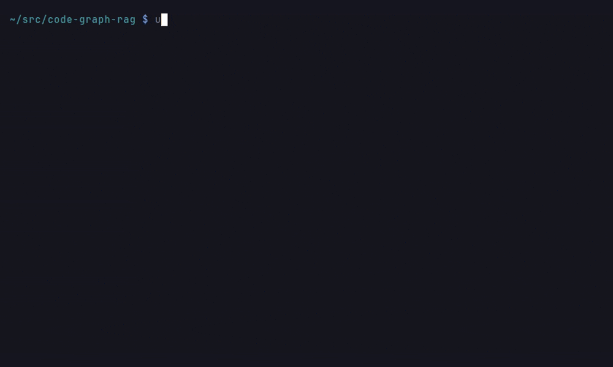
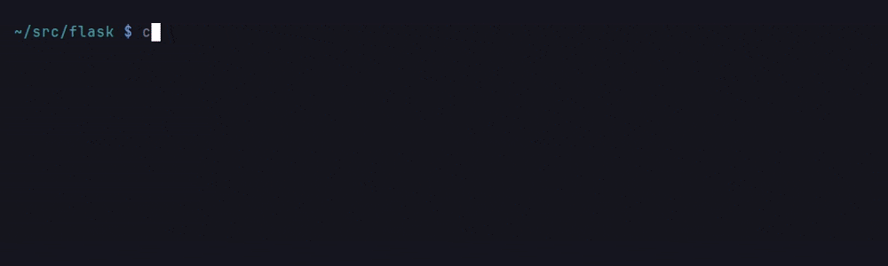

# Adding Languages

Code-Graph-RAG can add support for any language that has a Tree-sitter grammar. Adding one is a change to Code-Graph-RAG itself: a grammar submodule under `grammars/` and an entry in `codebase_rag/language_spec.py`. The `cgr language add-grammar` command automates that change inside a clone of this repository.

!!! warning "Contributor tool: it needs a source checkout"
    `add-grammar`, `remove-language` and `cleanup-orphaned-modules` edit the code-graph-rag **source checkout** that the running `cgr` was imported from, whatever your current directory is. They never touch the repository you happen to be in.

    If you installed `cgr` from PyPI, with `pipx`, or with `uv tool install`, there is no checkout to edit. These commands then refuse with an error, exit non-zero, and change nothing. Clone the repository and run them there, or [submit a language request](https://github.com/vitali87/code-graph-rag/issues).

!!! note
    While you can add languages yourself, we recommend waiting for official full support to ensure optimal parsing quality, comprehensive feature coverage, and robust integration.

## Quick Start

Clone the repository and run the tool from the clone:

```bash
git clone https://github.com/vitali87/code-graph-rag.git
cd code-graph-rag
uv run cgr language add-grammar <language-name>
```

Examples:

```bash
uv run cgr language add-grammar c-sharp
uv run cgr language add-grammar php
uv run cgr language add-grammar ruby
uv run cgr language add-grammar kotlin
```



*Recorded in a fresh clone of code-graph-rag; the grammar is removed again with `remove-language`.*

## Custom Grammar Repositories

For languages hosted outside the standard tree-sitter organisation:

```bash
uv run cgr language add-grammar --grammar-url https://github.com/custom/tree-sitter-mylang
```

## What Happens Automatically

When you add a language, the tool automatically:

1. **Downloads the Grammar**: Clones the tree-sitter grammar repository as a git submodule of the checkout, under `grammars/`
2. **Detects Configuration**: Auto-extracts language metadata from `tree-sitter.json`
3. **Analyses Node Types**: Automatically identifies AST node types for functions/methods, classes/structs, modules/files, and function calls from `node-types.json`
4. **Updates Configuration**: Adds the language to `codebase_rag/language_spec.py`
5. **Enables Parsing**: Makes the language available for codebase analysis (the grammar itself is compiled on first use by the parser loader)

If any step fails, for example the grammar cannot be cloned or `language_spec.py` cannot be updated, the command removes the submodule it added, leaves the checkout as it found it, and exits non-zero. A grammar that was already a submodule before the run is left in place.

## What does NOT happen automatically

Everything above is derived from the grammar's own `tree-sitter.json` and
`node-types.json`. Anything that depends on what the language *means* is not,
and cannot be, inferred from those files.

A grammar added this way gets **definitions and calls**. Everything below the
line needs language-specific code that someone has written:

| Derived from the grammar | Needs language-specific code |
|---|---|
| Functions, methods, classes | Inheritance (`extends`, `with`, mixins) |
| Modules and files | Import resolution and aliasing |
| Call sites | Qualified-name construction rules |

C# and Dart show where that code lives: dedicated extraction paths
(`split_csharp_bases` and `extract_dart_parent_classes` in
`class_ingest/parent_extraction.py`; the `CSharpImporter` and
`DartImporter` in `parsers/csharp/imports.py` and `parsers/dart/imports.py`),
with the language's own helpers in its package under
`codebase_rag/parsers/<language>/`.

What matters is that **somebody wrote it for that language**. `add-grammar`
does not, and cannot: the shape of an `extends` clause or an import alias is
not in `node-types.json`.

Measured example, since fixed: Scala **used to be** in exactly this state —
node types wired, no language-specific extraction. It produced classes,
objects, traits, methods, modules and CALLS edges, and **no inheritance edges
at all**, because `extends A with B` is a grammar production nothing had been
taught to read. Its imports resolved to nothing for every form.

Closing those gaps meant reading the grammar and deciding what the constructs
mean — that `with` introduces mixins, that `import a.{B => C}` binds `C` and
not `B`. None of it is in `node-types.json`, which is why the gap existed for
as long as it did and why nothing reported it.

**The failure is silent.** A partially-supported language produces a graph,
not an error. Queries return fewer results rather than reporting that a
relationship kind is missing, so nothing tells you the graph is thinner than
the code.

So treat `add-grammar` as *"parse this language"*, not *"support this
language"*. If you need inheritance or import edges, someone has to write the
language-specific extraction — in the language's package under
`codebase_rag/parsers/`, reached from the per-language branches of
`class_ingest/parent_extraction.py` and the importer lookup in
`import_processor.py`, as C# and Dart do.

The [support matrix](../architecture/language-support.md) is the authority on
what each shipped language actually provides; the files in a language's
package are not. For compiler-backed facts on top of the Tree-sitter
backbone, see [Adding a Language Frontend](../architecture/language-frontends.md).

## Where language-specific code lives

The pass modules (`import_processor.py`, `call_processor.py`,
`call_resolver.py`, `definition_processor.py` and `class_ingest/`) own the
language-neutral algorithm and reach a language's code through one dispatch
per language. Code that reads a language's syntax or applies its rules
belongs in that language's package, `codebase_rag/parsers/<language>/`: its
parser utils, its type-inference engine, its compiler frontend
(`frontend.py`, beside the tool it drives) and helpers such as
`parsers/rust/cargo.py` and `parsers/rust/source_scan.py`.

Put new language-specific behaviour there, as a function or engine method
the pass calls through its per-language dispatch, rather than as a new
`if language == ...` branch with the logic inlined in a pass module. Older
per-language method groups still sit in the pass modules and are moving into
the language packages one language at a time. Import handling has moved for
every language: `ImportProcessor` builds one importer per language package
(`RustImporter` in `parsers/rust/imports.py`, `JsTsImporter` in
`parsers/js_ts/imports.py`, and so on), looks a file's language up to hand
the importer its imports, and keeps the shared import map, the import sites
and the deferred IMPORTS edges and their flush for itself. A new language's
import parsing goes in an importer in its own package, registered in that
lookup.

The call pass has moved Go, C++, Dart and C# the same way: `CallProcessor`
builds a `GoCallResolution`, `CppCallResolution`, `DartCallResolution` and
`CSharpCallResolution` (each in `parsers/<language>/calls.py`) and hands
each its language's callee binding, fan-outs and the edges the language
writes without a call node. It keeps for itself the scan of a caller's
calls, the site and resolution every edge carries (`parsers/edge_site.py`
holds the part a collaborator writes through) and the name-based resolver.

## Example: Adding C# Support

```bash
$ uv run cgr language add-grammar c-sharp
Search: Using default tree-sitter URL: https://github.com/tree-sitter/tree-sitter-c-sharp
OK Submodule added at: grammars/tree-sitter-c-sharp
Auto-detected extensions: ['.cs']
Functions: ['destructor_declaration', 'method_declaration', 'constructor_declaration']
Classes: ['struct_declaration', 'enum_declaration', 'interface_declaration', 'class_declaration']
Modules: ['compilation_unit', 'file_scoped_namespace_declaration', 'namespace_declaration']
Calls: ['invocation_expression']
OK Language 'c-sharp' added
Note: Updated /path/to/code-graph-rag/codebase_rag/language_spec.py
```

## Managing Languages

```bash
cgr language list-languages
cgr language list-languages --verbose

uv run cgr language remove-language <language-name>
```

`list-languages` only reads, so it works from any install. It shows every language by tier and whether its grammar is installed; `--verbose` adds the node types each tree-sitter language maps, so you can check what `add-grammar` detected. `remove-language` edits the source checkout, like `add-grammar`, and exits non-zero when the language was not removed.

## Language Configuration

Each language is defined in the `LANGUAGE_SPECS` dict in `codebase_rag/language_spec.py`:

```python
"language-name": LanguageSpec(
    language="language-name",
    file_extensions=[".ext1", ".ext2"],
    function_node_types=["function_declaration", "method_declaration"],
    class_node_types=["class_declaration", "struct_declaration"],
    module_node_types=["compilation_unit", "source_file"],
    call_node_types=["call_expression", "method_invocation"],
),
```

## Troubleshooting

**Grammar not found**: Use a custom URL if the automatic URL doesn't work:

```bash
uv run cgr language add-grammar --grammar-url https://github.com/custom/tree-sitter-mylang
```

**"modifies a code-graph-rag source checkout"**: the `cgr` you ran is an installed copy, so there is no checkout to edit. Clone the repository and run `uv run cgr language ...` inside the clone, or request the language.



**Version incompatibility**: If you get "Incompatible Language version" errors:

```bash
uv add tree-sitter@latest
```

**Missing node types**: The tool automatically detects common node patterns, but you can manually adjust the configuration in `language_spec.py` if needed.
