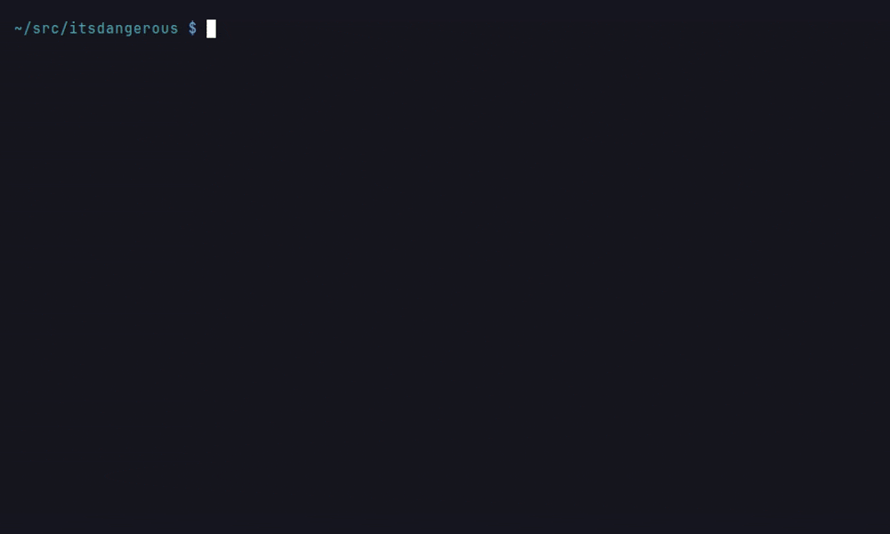

# Adding a Language Frontend

Tree-sitter is the backbone: it parses every supported language and produces the
graph on its own. A **frontend** layers a real compiler or language server on
top of one language, supplying facts Tree-sitter cannot derive — which
declaration a call actually binds to, whether a callee leaves the repository,
what a macro expanded to.

The invariant every frontend preserves: **a missing toolchain degrades to
today's behaviour, never worse.** If the compiler is absent, unavailable, or
slow, the graph is the Tree-sitter graph. A frontend adds precision; it never
subtracts coverage.

## The protocol

`LanguageFrontend` lives in `codebase_rag/parsers/frontends/protocol.py`. Your
frontend runs a compiler, translates what it learned into a `SemanticFacts`
bundle, and returns it. The graph builder applies the facts and writes nothing
you did not describe.

```python
class LanguageFrontend(Protocol):
    language: SupportedLanguage

    def available(self) -> bool: ...
    def applies(self, repo_path: Path) -> bool: ...
    def run(self, repo_path: Path, files: Sequence[Path]) -> SemanticFacts: ...
```

C#, Go, Java and Python are implemented this way, and each one's compiler run
answers in `SemanticFacts` directly rather than through a private bundle.

!!! note "C++ writes graph elements itself"

    libclang contributes what is not a fact *about* a Tree-sitter node but a
    node or edge in its own right: expanded macros and `#include` edges. It
    writes through the ingestor, needs the discovered `compile_commands.json`
    directory, and in HYBRID mode hands back macro uses to be attributed after
    Pass 2. The graph builder calls it directly (`_run_cpp_frontend`); no other
    language needs that shape, so there is no second protocol for it.

## The fact families

`SemanticFacts` is a bundle of independent families. **Every family is optional.**
Fill the ones your compiler models; leave the rest empty. Each is applied
separately, and any site your frontend did not describe falls back to the
Tree-sitter heuristics.

| Family | What it carries |
|---|---|
| `resolved_call_sites` | The declaration a call binds to |
| `external_sites` | Sites proven to leave the repository |
| `base_kinds` | Base types, distinguishing `INHERITS` from `IMPLEMENTS` |
| `implements_pairs` | `IMPLEMENTS` for structurally-typed languages with no base list |
| `arg_flows`, `bind_flows`, `out_writes` | Data-flow facts backing `FLOWS_TO` |
| `partial_groups`, `query_calls` | C#-specific today |

### Three states, not two

The distinction that matters most, and the one most easily got wrong:

- **key in `resolved_call_sites`** — analysed, and it binds *here*;
- **key in `external_sites`** — analysed, and it leaves the repo, so the
  name-trie must **not** fabricate a first-party edge;
- **key in neither** — not analysed. Fall back to the heuristics.

"Found nothing" and "did not look" are different facts, and they are two
separate collections so that a consumer can tell them apart.

### When you cannot resolve to exactly one target

Omit the fact. Do not guess.

`resolved_call_sites` maps one key to one target, so a site with several
plausible bindings has no representation — and that is deliberate. The Python
frontend shows the intended handling:

```python
def _single_resolvable_target(names):
    # Exactly one inferred function/class is a usable fact; anything else
    # (ambiguity, modules, instances) is the ceiling: no fact, never a guess.
    if len(names) != 1:
        return None
    name = names[0]
    if name.type not in _RESOLVABLE_TYPES:
        return None
    return name
```

A site you decline to describe degrades to the heuristic, which is correct. A
site you describe wrongly poisons the graph, and nothing downstream can tell.

This is a known limit rather than an oversight: a frontend that *knows* three
candidates cannot say so, and the trie re-derives them less well. Languages
whose dispatch is genuinely dynamic — Ruby `method_missing`, mixin ancestry,
`noSuchMethod` — will hit it first. Raise it with the concrete case when you do.

## The join key

```python
CallSiteKey = tuple[str, int, int, str]
# (rel_file, name_token_line, name_token_byte_col, simple_name)
```

Two details, both load-bearing:

**The NAME token, not the expression start.** Nested invocations such as
`Make().Handle(x)` share a start position; their name tokens never collide.

**Columns are UTF-8 BYTE offsets.** Tree-sitter is byte-oriented. A compiler
reporting UTF-16 columns (Roslyn) or character columns (Jedi) must re-measure
before building a key, or every join silently misses on any line containing a
non-ASCII character.

That failure mode deserves emphasis, because it has bitten this repository more
than once: the offsets agree exactly until a line contains a character outside
ASCII, and then they diverge by the difference. **An all-ASCII fixture cannot
distinguish byte offsets from character offsets from UTF-16 code units** — all
three are "correct" until they are not.

Byte columns are **line-relative**, so where you put the non-ASCII character
decides whether the fixture can see anything at all. A character on an earlier
line does not shift the target token's column, and such a fixture stays green
under a broken conversion. It has to sit **before the asserted token on the
same line**:

```python
x = café_var.method()  # `method` is at char column 13, byte column 14
x = plain_var.method()  # both are 14 -- this line proves nothing
```

Put it there, then deliberately break the conversion and
confirm the test fails. If it stays green, the fixture is not positioned to
catch anything.

## Availability and enablement

`available()` must answer "can this actually run", not "is something installed".
A tool present on disk whose runtime is missing is present, executable, and
non-functional — probe by invoking it, and treat any failure as unavailable.

Register a per-language enum following the existing pattern
(`constants/languages.py`), for example `PythonFrontend.HEURISTIC | JEDI`, and
register with `parser_fingerprint.py` so that changing mode invalidates the
incremental graph. A graph built with one frontend and updated with another is
worse than either.



*Recorded on pallets/itsdangerous: switching `PYTHON_FRONTEND` from the default `heuristic` to `jedi` changes the fingerprint, so the next sync re-parses every file.*

The fingerprint currently records the **resolved mode**, not the external
tool's version — so upgrading `go`, `javac` or `dotnet` reuses a graph the
older tool produced. That gap is tracked in #1465; `LOMBOK=` in
`_frontend_settings` shows the shape the fix takes. If your frontend drives a
tool whose output changes between versions, say so on that issue rather than
assuming the mode covers it.

## Shelling out

Always pass an explicit encoding:

```python
subprocess.run(..., text=True, encoding=cs.ENCODING_UTF8)
```

`text=True` alone decodes with the **locale** encoding — cp1252 on Windows —
while the tool you called almost certainly wrote UTF-8. `test_subprocess_encoding.py`
fails the build if you forget, so this is enforced rather than advisory.

## Checklist

1. Implement `available()` by probing, not by checking for a file.
2. Implement `applies()` — usually "is there a project file for this language".
3. Fill only the fact families your compiler genuinely models.
4. Build keys with byte columns, re-measuring if your tool reports otherwise.
5. Omit rather than guess whenever resolution is ambiguous.
6. Register at module scope with `register_frontend(...)` and import the
   module in `frontends/builtin.py`. Then add a `_run_<lang>_frontend` step to
   `GraphUpdater`, before or after the definition pass as your facts need,
   that calls `_run_frontend`. That is the one policy every frontend shares:
   it skips a frontend that is off or does not apply, says why when the
   toolchain is missing, and stores the bundle in
   `DefinitionProcessor.frontend_facts[language]`, where that language's
   resolver reads it. Nothing else needs a new field or a reset.
7. Add a per-language enum and a `parser_fingerprint.py` registration.
8. Write fixtures with a non-ASCII character **before the asserted token on the
   same line** (byte columns are line-relative), and prove they fail when
   the offset conversion is broken.

## The C++ modes

`CPP_FRONTEND` selects between three modes, and the choice is about what
libclang is allowed to own rather than about how hard it tries:

| Mode | Who owns definitions | Runs |
|---|---|---|
| `treesitter` | Tree-sitter | not at all |
| `hybrid` (default) | Tree-sitter | after the definition pass |
| `libclang` | libclang, for the files it covers | before the definition pass |

The pipeline order is the whole of the distinction, and getting it wrong fails
silently. HYBRID layers macro `Function` nodes and `#include` IMPORTS onto spans
Tree-sitter has already produced, so `GraphUpdater.run` calls it after the
definition pass; running it early would find no spans and attribute nothing.
LIBCLANG emits its own definition nodes and reports the files it covered so the
definition pass can skip them, so it runs before that pass; running it late
would let the definition pass process files it was meant to cede. Neither
raises. `test_cpp_frontend_phase.py` asserts the order per mode for that reason.

!!! warning "One genuine piece of migration is still outstanding"

    `cpp/qn.py` — the frontend-owned qualified-name generator — still
    exists, and `graph_updater.py` still keeps `_frontend_owned_qns`
    bookkeeping. That generator has to reproduce the graph builder's file-walk
    order byte for byte, which is the coupling that
    [#1025](https://github.com/vitali87/code-graph-rag/issues/1025) is about.

    Retiring it is tracked as the remaining scope on
    [#1178](https://github.com/vitali87/code-graph-rag/issues/1178). It does not
    affect anyone adding a *new* frontend — no other language needs a qn
    generator, because the join key carries position and the builder assigns
    qualified names — but it is why that issue is not closed.
