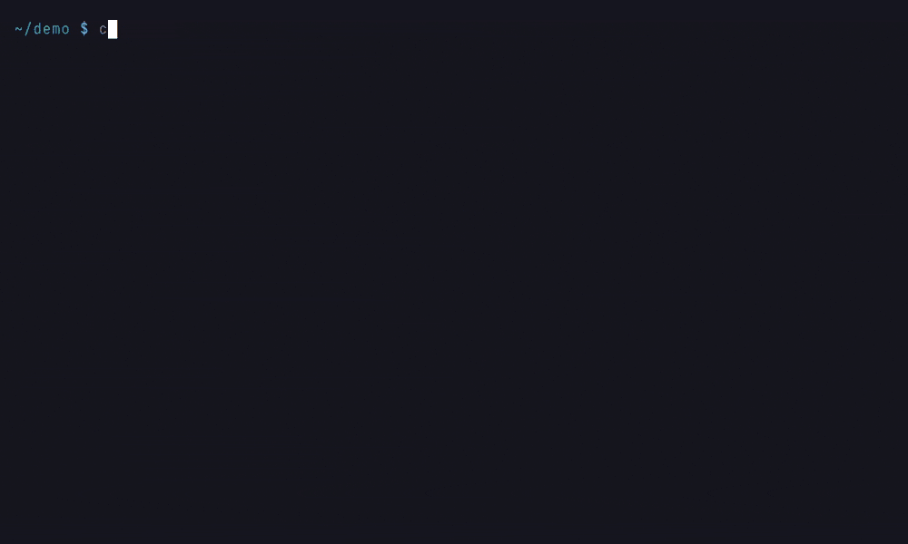

# Architecture Overview

Code-Graph-RAG has three layers. Ingestion turns source code into graph facts.
The graph store keeps them. The consumers are the agent CLI, the MCP server,
graph-aware editing and the analyses, and they query the store.

## Ingestion

Each sync walks the repository and writes the facts it finds under one
language-agnostic schema ([Graph Schema](graph-schema.md)).

- **Tree-sitter backbone.** The parsers in `codebase_rag/parsers/` read every
  supported language with Tree-sitter. They extract modules, classes,
  functions, methods, imports and calls, and resolve the calls across modules
  and inheritance. The backbone always runs, and every other source adds to it.
- **ast-grep tier.** Languages without a full parser (Ruby, Kotlin, Swift,
  Elixir, Haskell, Solidity, Bash, Nix) get structural support from ast-grep
  rules. This needs the `ast-grep` extra
  ([Language Support](language-support.md)).
- **Document tier.** Markdown and other documents are indexed as nested
  `Section` nodes by heading, so prose links into the code graph.
- **Compiler frontends.** Where a toolchain is available, a frontend adds
  exact facts: libclang for C/C++, `go/types` for Go, and opt-in Roslyn,
  `javac` and Jedi for C#, Java and Python
  ([Adding a Language Frontend](language-frontends.md)).
- **Runtime traces.** `cgr trace` records the calls a test run or a profile
  actually made and merges them into the graph. That exposes dispatch that
  static analysis cannot see ([Dynamic Tracing](../guide/dynamic-tracing.md)).

`cgr watch` and the MCP edit tools re-ingest only the files that changed, so
the graph keeps up with the working tree
([Real-Time Updates](../guide/realtime-updates.md)).

## Graph Store

By default the graph is an embedded SQLite file (`~/.cgr/graph.sqlite`), and no
server runs. `codebase_rag/embedded_graph/` compiles the Cypher the rest of the
code writes into SQL. The `cgr-graph-rs` Rust extension speeds up the engine
where a wheel exists; elsewhere a Python twin of each part runs instead.
Memgraph and Neo4j are opt-in backends that run the same Cypher, chosen with
`GRAPH_BACKEND` ([Graph Backends](embedded-graph.md)). Vector embeddings for
semantic search are kept in a SQLite vector file, or in Qdrant or Milvus.

## Consumers

- **Agent CLI.** `cgr start` answers questions in plain English. It translates
  them to Cypher, retrieves the matching source, and edits code with an
  approval step ([Interactive Querying](../guide/interactive-querying.md)).
- **MCP server.** `cgr mcp-server` exposes the deterministic graph tools, the
  natural-language query and the edit tools to any MCP client
  ([MCP Server](../guide/mcp-server.md)).
- **Graph-aware editing.** Renames, patchers and edit transactions in
  `codebase_rag/editing/` rewrite code with the graph's help, and check the
  result against it ([Rename Operation](rename.md),
  [Edit Transactions](edit-transactions.md)).
- **Analyses.** Dead code, duplicates, data-flow verdicts, context slices and
  structural deltas read the graph without an LLM.

## Data Flow

```
Source Code → Tree-sitter backbone ─┐
              ast-grep / documents ─┼→ Graph Store (embedded SQLite, or Memgraph / Neo4j)
              frontends / traces ───┘                    ↓
User Query → AI Model (Cypher Gen) → Cypher → Graph Results → Response
```



*The ingestion half of the flow; the query half needs an LLM provider.*

## Key Dependencies

| Dependency | Purpose |
|-----------|---------|
| `tree-sitter` | Language-agnostic AST parsing |
| `cgr-graph-rs` | Rust acceleration for the embedded graph engine |
| `pydantic-ai-slim` | Agent framework for LLM integration |
| `pydantic-settings` | Settings management |
| `mcp` | Model Context Protocol SDK |
| `typer` | CLI framework |
| `rich` | Terminal rendering |
| `prompt-toolkit` | Interactive command line |
| `watchdog` | Filesystem events monitoring |
| `pymgclient` | Memgraph driver, in the optional `memgraph` extra |
