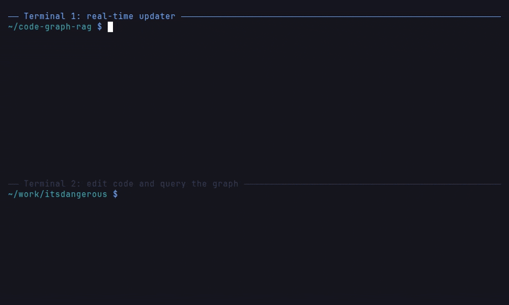

# Real-Time Graph Updates

For active development, keep your knowledge graph automatically synchronised with code changes using `cgr watch`.

## What It Does

- Watches your repository for file changes (create, modify, delete)
- Automatically updates the knowledge graph in real-time
- Re-parses only the changed file and the files that depend on it, and re-resolves calls in that set only (the same `GraphUpdater.reingest` path the MCP `reingest` tool uses)
- Filters out irrelevant files (`.git`, `node_modules`, etc.)

## Usage

Run the watcher in a separate terminal:

```bash
cgr watch --repo-path /path/to/your/repo
```

`cgr watch` comes with every install of `code-graph-rag` (`uv tool install`,
`pipx`, `pip`); it needs no clone of this repository. Without `--repo-path` it
watches the current directory. It first syncs the repository the way
`cgr start --update-graph` does, then applies each change as you save, until
you stop it with Ctrl+C.



*Terminal 2 edits `encoding.py`; the watcher re-ingests it (and its dependents) and the new function is in the graph.*

From a clone of this repository, the Makefile target and the contributor
script run the same command:

```bash
make watch REPO_PATH=/path/to/your/repo
python realtime_updater.py /path/to/your/repo
```

### With Custom Memgraph Settings

`cgr watch` connects the way every `cgr` command does: `MEMGRAPH_HOST` and
`MEMGRAPH_PORT` (and `MEMGRAPH_USERNAME` / `MEMGRAPH_PASSWORD`) from the
environment or `.env`. There are no separate `--host` / `--port` flags.

```bash
MEMGRAPH_HOST=localhost MEMGRAPH_PORT=7687 cgr watch --repo-path /path/to/your/repo --batch-size 1000
```

```bash
make watch REPO_PATH=/path/to/your/repo HOST=localhost PORT=7687 BATCH_SIZE=1000
```

Like `cgr start`, it starts the shared stack when it is not running; pass
`--no-start-stack` when you run Memgraph yourself.

### Debouncing

An editor's save is a burst of filesystem events, and a busy file changes
again before the graph has caught up. The watcher waits until a file has been
quiet for `--debounce` seconds (5 by default) and applies the burst as one
update. A file that keeps changing is still applied after `--max-wait` seconds
(30 by default). `--debounce 0` applies every change at once.

```bash
cgr watch --repo-path /path/to/your/repo --debounce 2 --max-wait 10
```

## Multi-Terminal Workflow

`cgr watch` resolves the repository and names the project exactly as
`cgr start` does for the same options (the directory name plus a hash of its
resolved path), so its live updates land in the project `cgr start` and the
other `cgr` commands read. If you name the project with `--project-name`,
pass the same name to both.

```bash
# Terminal 1: keep the graph in sync
cgr watch --repo-path ~/my-project

# Terminal 2: Run the AI assistant
cgr start --repo-path ~/my-project
```

### Refused as `cgr start` refuses it

- A home directory or the filesystem root. `--repo-path` defaults to the
  current directory, so `cgr watch` run from `$HOME` would index every file
  under it and watch them all. Pass `--repo-path <repository>`, or `--yes` to
  watch it anyway.
- A `--project-name` another repository already indexes, which the watcher
  would replace. Choose another name, or pass `--yes` to take the project
  over. The watcher claims the name for its repository before the first scan
  and holds to that claim on every write: if another repository takes the
  name over meanwhile (`cgr start --yes`), the watcher logs each later change
  as refused instead of writing it.

Every write the watcher makes (the first scan, a full re-index, each change
it applies) goes under the incomplete-run marker `cgr start --update-graph`
puts down, which comes off only once that write has finished. A watcher
stopped part-way through a write therefore shows in `cgr status` as an
unfinished sync, and the MCP server does not trust the partial graph, until
the next sync of the project finishes. A change that arrives while another
sync of the project has left its marker down re-indexes the whole repository
instead of applying that change alone. A full sync (`cgr start
--update-graph`, or the MCP server's `update_repository` and
`index_repository`) also takes off the marker an MCP server's run left when
it stopped part-way through a write, which nothing else clears: it rebuilds
the whole repository first, then retires that marker with its own. It does so
only once the process that wrote the marker has exited on this machine. A run
still going, even one from another checkout under the same project name, keeps
its marker, and so does a run on another machine or in another container. A
marker an older release wrote names no process, so it stays too. The check
needs a machine whose processes cannot be mistaken for another machine's:
Linux, where the boot id and the pid namespace tell them apart. On macOS and
Windows, which name the machine by its hostname alone, such a marker stays,
as it did before.

### One sync of a checkout at a time

Every writer of a checkout (`cgr start --update-graph`, `cgr index`, the MCP
server's index and update tools, `cgr watch`, `cgr check` and the MCP
`reingest`) takes the checkout's sync lock, `.cgr-sync-lock`, in the
checkout's directory under `CGR_HOME` beside its other sync state (see
[cgr's own state](../advanced/ignore-patterns.md#cgrs-own-state)); nothing is
written into the repository. Two syncs of one checkout at once would
interleave their deletes and re-creates and leave the graph incomplete, so:

- A full sync started while another holds the lock stops before it changes
  anything and names the running one:
  `Another sync of /path/to/repo is running (pid 4242, project 'repo__a4231746') ...`.
  Run it again when that sync has finished.
- The first scan of `cgr watch` and every scoped reingest (a watched change,
  an MCP edit's reingest, `cgr check`) wait for the running sync instead, then
  apply their change to the graph it finished. While `cgr watch` applies a
  change, a `cgr start --update-graph` of the same checkout is refused the
  same way, naming the watcher's project.

The lock is an OS file lock, so a sync that crashes or is killed releases it
with its process; there is never a stale lock to delete. Like the rest of the
state under `CGR_HOME`, it is per user: syncs run by users with separate
`CGR_HOME` directories do not exclude each other, so give users who sync one
checkout into one graph a shared `CGR_HOME`, or sync it from one account.

A lock file the current user can read but not write, on a read-only
`CGR_HOME` or one another user of a shared `CGR_HOME` created, is locked
through a read-only handle, so it still keeps a second sync out. The holder's
name is not recorded then, so a refused sync may name an earlier one. When
there is no lock file and `CGR_HOME` cannot be written to create one, the
sync still runs, as it does without its incremental state, but without the
lock: it logs a warning that concurrent syncs of the checkout are not
excluded. Point `CGR_HOME` at a writable directory to keep the lock.

The lock file is never opened through a symbolic link: a link at its path is
refused with a message naming it, since writing the holder's name through the
link would overwrite whatever file it points at. A lock file the current user
cannot open at all, not even to read it, is refused too, with the reason:
without the lock a sync cannot tell whether another one is running. Make the
file readable and writable for every user who syncs the checkout. A
`.cgr-sync-lock` in the repository itself is not the lock and is left alone.

A write Memgraph rejects as a conflicting transaction is retried a few times
with a short, growing wait before it is reported.

## Options

<!-- SECTION:cli_options_watch -->
| Option | Description |
|------|-----------|
| `--repo-path` | Repository to watch. Defaults to the current directory. |
| `--project-name` | Project name to store in the graph. Defaults to the name `cgr start --repo-path` gives the same repository, so both update one project; if you passed `cgr start --project-name`, pass the same name here. |
| `--debounce`, `-d` | Seconds to wait after a file's last change before updating the graph, so a burst of saves becomes one update. 0 applies every change at once. [default: 5; x>=0] |
| `--max-wait`, `-m` | Longest a file that keeps changing waits before the graph is updated anyway. Raised to --debounce when lower. [default: 30; x>=0] |
| `--batch-size` | Flush to Memgraph after this many buffered nodes or relationships. [x>=1] |
| `--no-start-stack` | Do not start the shared stack automatically. |
| `--yes`, `-y` | Watch even a home directory or the filesystem root, and take over a --project-name another repository already indexes, as cgr start --yes does. |
<!-- /SECTION:cli_options_watch -->

The same table is in the [CLI reference](cli-reference.md#cgr-watch).

## Performance Note

The updater batches rapid saves with a debounce window. Each processed change
runs `GraphUpdater.reingest`, which deletes what the file previously
contributed, re-parses it together with the files that import or call into it
(one level deep, found through the graph's own edges), resolves calls within
that set only, and restores every other inbound edge verbatim. A change in one
file therefore costs the parse of its affected dependents rather than a
re-resolution of the project (a hub file imported by dozens still pays for each
of them); see [Scoped re-ingest latency](../reports/REINGEST_BENCHMARK.md)
for measured numbers.

An edit that leaves the file's interface as it was skips its dependents
altogether. A comment, a reformatted line, or a change inside a function body
that no other file's call resolution reads all count. The file's Module records
an `interface_fingerprint`: its definitions, signatures, annotations, bases and
module-level statements, plus the parts of function bodies that cross-file
type inference reads and the functions a body hands to other files as call
arguments (a constructor argument filling a field another file invokes, a
callback forwarded to the function that calls it). When the new source hashes
to the same value, the dependents keep their edges and only the edited file is
re-parsed. A function body whose returned or forwarded values are read through
a local it binds (`r = A(); return r.run`) is hashed whole, so any edit to it
re-parses the dependents. A dependent whose edges with the file could not be
restored by name is still re-parsed, and so is every dependent of a file
holding a function that invokes a callable another file passes it, since that
file's parse cannot rebuild the flow edge on its own. The same rule applies to
`cgr start --update-graph`. Python, Java, JavaScript and TypeScript files carry
the fingerprint; the dependents of any other file are re-parsed as before, as
they are when a capture group beyond the default ones is enabled or a semantic
frontend (Jedi, javac) is selected.

Agents that edit files directly can call the MCP `reingest` tool with the paths
they touched instead of waiting for the watcher or running `update_repository`.
