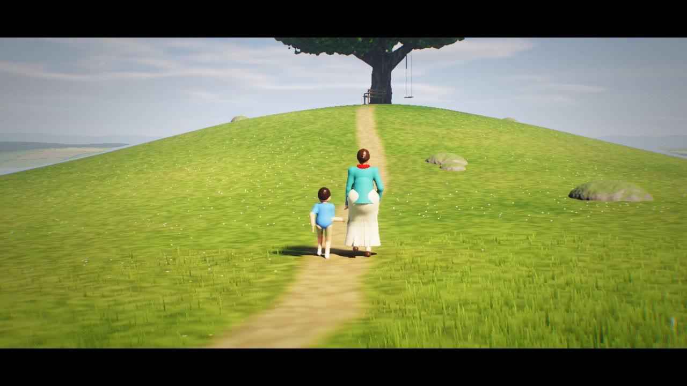
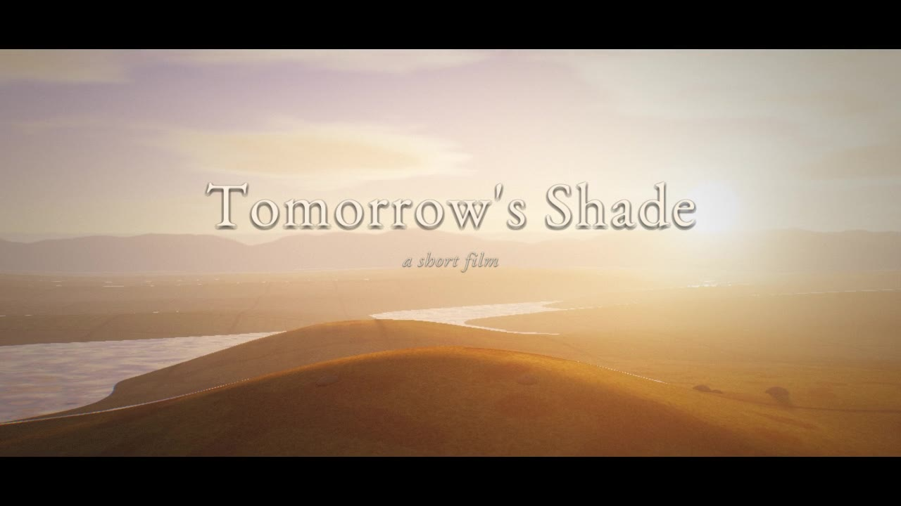
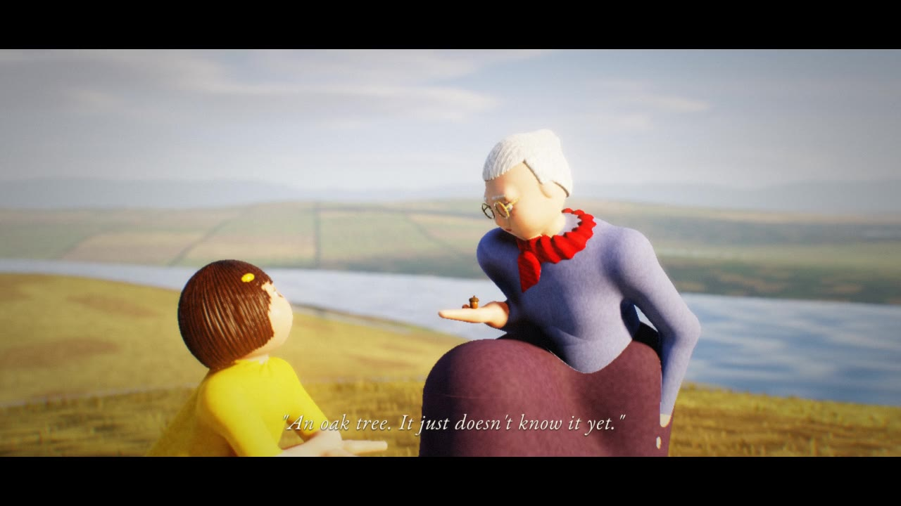
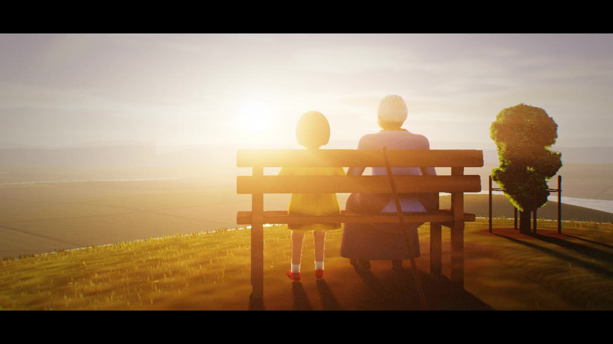
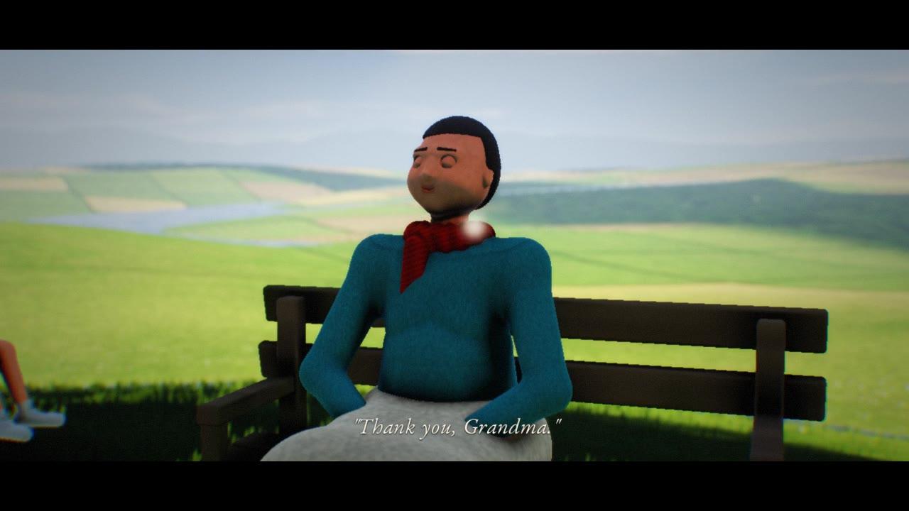

# Tomorrow's Shade

*A short animated film made with [raylib](https://www.raylib.com/), about planting trees whose shade you will never sit in.*



## The story

At dawn, a grandmother walks her granddaughter Mira up a bare, windswept hill. She kneels,
digs a small hole and opens her hand: an acorn.

> "What is it, Grandma?"
> "An oak tree. It just doesn't know it yet."

Mira works it out. The tree will take a lifetime to grow, so her grandmother will never sit in
its shade. "It isn't for me, sweetheart."

The seasons turn. The sapling gets a little fence, the hill gets a bench, and the two of them
keep visiting, through autumn leaves, snow and spring. One summer evening, watching the sunset
from the bench, the grandmother wraps her red scarf around Mira's shoulders: "Shade was never for
the one who plants the tree. It's a gift for someone you may never meet."

Then the bench is empty, and Mira stands alone by the young tree in the red scarf.

Decades pass in seconds. The oak grows into a giant and the barren hill turns into a meadow.
Mira, grown up, walks the same path with her own son and sits in the cool, dappled shade her
grandmother planted. The boy finds an acorn in the grass: "Mama, what's this?" She knows the answer.

They plant it together. As the camera rises, young trees are growing on every hill around.

Running time is about 4 minutes 45 seconds, with an original procedural score.

| | |
|---|---|
|  |  |
|  |  |

## Build and watch

Requirements: a C99 compiler, `make`, `git`, an OpenGL 3.3 capable GPU, and the usual raylib
system dependencies (on Debian/Ubuntu: `libx11-dev libxrandr-dev libxinerama-dev libxcursor-dev
libxi-dev libgl1-mesa-dev libasound2-dev`).

```sh
cd examples/tomorrows_shade
make          # downloads and builds raylib 5.5 into third_party/ the first time
make run      # plays the film with sound
```

Controls: `space` pause, `←/→` seek 10 s, `r` restart, `f` fullscreen, `esc` quit.
If playback stutters on a slower GPU, render at a lower internal resolution, for example
`./tomorrows_shade --scale 0.6`.

### Render to a video file

```sh
make video                                            # 1280x720, 24 fps, with the score
./tomorrows_shade --record film.mp4 --size 1920x1080 --ss 1.5   # supersampled 1080p
./tomorrows_shade --still 214 frame.png                # a single frame at t = 214 s
```

Recording renders deterministically, frame by frame, and pipes the frames to `ffmpeg`, which
must be on your `PATH`. It works headless too (for example under `xvfb-run`).

## How it is made

There are no models, textures or sound files apart from the font. Everything is generated
procedurally at startup or rendered per pixel.

- **A raymarched world** (`shaders/scene.fs`). The terrain, the oak, the people, the bench,
  the watering can and the acorn are all signed distance fields. They are lit with a sun and sky
  model, soft shadows, ambient occlusion, subsurface scattering on skin and leaves, translucency
  and height fog with sun scattering.
- **The sky**: a time-of-day sky model, billowy self-shadowed clouds with silver linings, cirrus
  that catches dawn and dusk colours, layered distant mountains, stars, a moon and the Milky Way.
- **The oak** (`src/tree.c`) grows from a mature branch hierarchy that is replayed at any age:
  tall and slender when young, broad and gnarled when old. Its crown is a cloud of noise-carved
  leaf clusters, and the light under it is a volumetric leaf density, which gives soft dappled
  shade. The seasons drive the leaf colour, how full the crown is, snow and the colour of the grass.
- **People** (`src/character.c`) have skeletons solved with two-bone IK and walk cycles with
  planted feet. They can kneel, squat, sit and hold hands, and they blink and talk. Their faces
  are modelled in the shader with eyes that follow a gaze target, eyelids, lashes and catchlights.
  They have hair, knitted clothes and skirts that drape over the knees.
- **Grass** (`src/grass.c`): about 25,000 blades are generated around the camera every frame and
  rasterised on top of the raymarched image. They are depth-tested against it, sway in rolling
  gusts, and take their colour from the lit ground beneath them, so shadows match.
- **Particles** (`src/particles.c`): falling leaves, snow, spring petals, fireflies, dandelion
  seeds, dust motes in the light, water from the can and birds. Each one is a pure function of
  time, so the film can be scrubbed and recorded exactly.
- **Post-processing**: an HDR pipeline with a bloom mip chain, crepuscular rays, gather depth
  of field, ACES tone mapping, grading, vignette, chromatic fringe, film grain and a 2.2:1 letterbox.
- **The score** (`src/audio.c`) is synthesised at startup: an additive piano with string
  inharmonicity, a bowed string section, a celesta, a cello and a Freeverb reverb, arranged
  against the shot timings, plus wind, birdsong, crickets and water.
- **The story** (`src/story.c`) is a timeline of 22 shots with cameras, lighting, seasons,
  blocking, captions and dissolves.

## Credits

Written, animated and scored in code. Captions and titles use
[EB Garamond](https://github.com/georgd/EB-Garamond) by Georg Duffner, under the SIL Open Font
License (see `assets/fonts/OFL.txt`).

"A society grows great when old men plant trees whose shade they know they shall never sit in."
— Greek proverb
